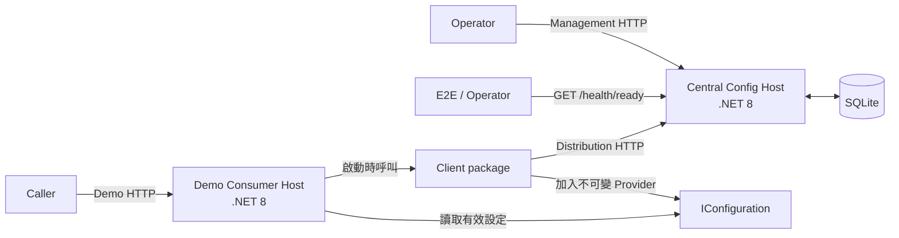

# Config Distribution POC

Config Distribution POC 使用 .NET 8 驗證集中式設定發佈。Central Config Host 管理共享設定值。Consumer Application 在啟動時透過 Client 取得所選的 Configuration Keys。Client 將中央值加入 .NET `IConfiguration` pipeline。Central Config Host 不註冊 Consumer Application。

> [!WARNING]
> 此 POC 只適用於隔離的示範環境，不可用於正式環境。它不提供身分驗證、授權、認證資料、強制 TLS、執行階段更新、離線快取或正式環境維運。只使用非敏感資料。

## 第一次閱讀

不熟悉集中式設定或 .NET `IConfiguration` 時，先讀[短入門導讀](docs/getting-started.md)。導讀以白話概念與一個設定鍵的完整流程，說明設定來源、優先序、啟動快照與缺值行為，並提供後續閱讀路線。

## 專案全貌

初始 .NET 8 POC 包含三個交付物：

- **Central Config Host**：提供 Management、Distribution 與一個 Operational readiness HTTP interface。SQLite 在 POC 資料庫的生命週期內保留完整版本歷史。
- **Client package**：在 Consumer Application 啟動時載入中央設定，並建立不可變的設定快照。
- **Demo Consumer Host**：使用 Client public API，並顯示所有設定來源合併後的有效設定。一般 solution build 使用 `ProjectReference`。Packaged E2E tests 與示範手冊使用實際封裝的 Client。

初始 POC 已完成 Central Host、Client package、Demo Host、跨程序 E2E Scenarios A～J 與人工示範手冊。本文件說明如何理解、驗證及示範目前的 POC。

## 目標與邊界

此 POC 證明下列行為：

- 同一個 `(Environment, Configuration Key)` 只對應一份共享中央值。不同的 Consumer Application 不會取得各自專屬的中央值。
- Set、Remove 及再次 Set 都會附加新的 Entry Version。系統不會覆寫或實體刪除歷史。
- Consumer Application 擁有 Key Selection，並為每個 key 指定 Central Required 或 Fallback Allowed。
- Client 依有上限的重試與逾時策略取得中央值。Client 驗證完整回應後，才加入不可變的 Provider。
- 實際執行的 Central／Demo 程序與 packaged Client 共同驗證啟動、失敗、快照、優先序、歷史與恢復能力。

完整成功條件、HTTP 契約、持久化規則與非目標，詳見 [POC 設計規格](docs/design/config-distribution-poc.md)。

## 架構一覽



設定值從管理到使用的流程如下：

1. Operator 透過 Management interface Set 或 Remove 中央值。
2. Central Host 在單一 SQLite transaction 內附加下一個 Entry Version。
3. Consumer Application 啟動時，Client 透過 Distribution interface 批次查詢 Key Selection。如果發生重試，Client 會送出多次 HTTP 請求。
4. Client 確認回應與查詢的 Configuration Keys 完全相符，且每個 key 只出現一次。接著，Client 套用 Missing Behavior，並加入不可變的 Provider。
5. Demo Host 端點讀取最終的 `IConfiguration`。這些端點不會在處理請求時查詢 Central Host。

Consumer Application 啟動後，Central Host 的 Set 或 Remove 不會改變其設定。重新啟動 Consumer Application，才能取得新的快照。

## 核心概念與執行行為

| 概念 | 在本專案中的意思 |
| --- | --- |
| **Environment** | 中央部署分區。名稱不分大小寫，由 Consumer Application 明確指定。 |
| **Host Environment** | .NET Host 的執行環境。它與中央的 Environment 相互獨立。 |
| **Configuration Key** | 以 `:` 分隔的 canonical 名稱。名稱不分大小寫，且 `CentralConfig` 是保留的根區段。 |
| **Entry Version** | Central Host 編號的不可變歷史狀態。最新版本決定設定值為 Present 或 Removed。 |
| **Key Selection** | Consumer Application 宣告所需的 keys 與各 key 的 Missing Behavior。Central Host 不保存 Consumer Application 登錄資料。 |
| **Central Required** | 中央值不存在時，Consumer Application 無法啟動。即使本機 Provider 有同名值，此規則仍適用。 |
| **Fallback Allowed** | 中央值不存在時，Client 不提供該 key。其他 configuration providers 決定有效值。 |
| **Startup snapshot** | Client 成功載入後建立的不可變 Provider。它不會輪詢、接收推送或在執行階段更新。 |

設定來源的優先序由低到高如下：

1. `appsettings.json`
2. `appsettings.{HostEnvironment}.json`
3. central startup snapshot
4. User Secrets
5. Environment Variables
6. command-line arguments

精確術語以 [`CONTEXT.md`](CONTEXT.md) 為準。

## Repository 結構

```text
Demo.DotnetCore.ConfigService.sln
├─ src/
│  ├─ Demo.DotnetCore.ConfigService.CentralHost/
│  ├─ Demo.DotnetCore.ConfigService.Client/
│  └─ Demo.DotnetCore.ConfigService.DemoHost/
├─ tests/
│  ├─ Demo.DotnetCore.ConfigService.CentralHost.Tests/
│  ├─ Demo.DotnetCore.ConfigService.Client.Tests/
│  ├─ Demo.DotnetCore.ConfigService.DemoHost.Tests/
│  └─ Demo.DotnetCore.ConfigService.EndToEnd.Tests/
└─ docs/
```

`Demo.DotnetCore.ConfigService.sln` 是 project 清單的依據。下表摘要各 project 的責任。

| Project | 主要責任 |
| --- | --- |
| `CentralHost` | 驗證 HTTP 請求，執行 Management／Distribution 操作，提供 Operational readiness 與 immutable launch-scoped `instanceId` 的 launch-correlation ownership，並以 SQLite 保存版本歷史。 |
| `Client` | 驗證 bootstrap、呼叫 Distribution interface、處理重試／逾時／取消與診斷，並加入 snapshot Provider。 |
| `DemoHost` | 使用 Client public API 載入中央值，並提供 scoped 與 unsafe 端點。 |
| `CentralHost.Tests` | 驗證 domain、SQLite、HTTP contracts、readiness／launch identity、error mapping、contention 與 Host lifecycle。 |
| `Client.Tests` | 驗證 bootstrap、transport、response parsing、resilience、diagnostics、Provider precedence 與 package contract。 |
| `DemoHost.Tests` | 驗證 effective configuration、startup markers、路由、headers 與 checked-in settings。 |
| `EndToEnd.Tests` | 使用實際 Central／Demo 子程序、獨立的連接埠、SQLite 資料庫與暫存根目錄，以及 packaged Client 驗證完整流程與 matching launch identity ownership。 |

## 快速開始

### 必要工具

- 安裝 Git，以執行版本控制與 whitespace 檢查。
- 安裝 PowerShell，以執行人工示範手冊。
- 安裝任一 .NET SDK 10.0.x（[`global.json`](global.json) 要求 10.0.100 以上的 10.0 版本；SDK 8 的編譯器與格式檢查不相容），以及 .NET 8 ASP.NET Core 執行階段。所有 source 與 test projects 都以 `net8.0` 為目標。
- 從包含 `Demo.DotnetCore.ConfigService.sln` 的 repository root 執行下列命令。

### 完整驗證

依序執行下列命令：

```powershell
dotnet restore Demo.DotnetCore.ConfigService.sln -maxcpucount:1 -nodeReuse:false
dotnet format Demo.DotnetCore.ConfigService.sln --verify-no-changes --no-restore
dotnet build Demo.DotnetCore.ConfigService.sln -c Release --no-restore -maxcpucount:1 -nodeReuse:false -p:EnforceCodeStyleInBuild=true
dotnet test Demo.DotnetCore.ConfigService.sln -c Release --no-build --no-restore -maxcpucount:1 -nodeReuse:false
git diff --check
```

先完成相同原始碼的 Release build，再執行包含 `--no-build` 的 `dotnet test`。在 Windows 上使用單節點並停用 node reuse，可避免遺留閒置的 MSBuild workers。

## 逐步呼叫 API 演示

向團隊逐步展示時，使用 [HTTP 演示操作說明](docs/demo/http-demo-guide.md) 搭配 [HTTP 呼叫檔](docs/demo/config-distribution-demo.http)。依序發送請求，觀察兩個使用端共用同一份中央值、本機後備值、啟動快照、必要設定鍵缺值時的啟動失敗，以及版本歷史。操作說明提供持續運作的服務啟動方式，並標示需要手動重啟 Demo 的步驟。

這個短演示使用 `ProjectReference` 連結 Client，不取代 packaged E2E tests 或下列完整示範。

## 執行完整示範

[POC 示範手冊](docs/demo/config-distribution-poc-runbook.md) 提供可重現的完整程序：

- 建置並封裝 Client package。
- 使用隔離的 package cache 還原並建置 Demo Host。
- 啟動 Central Host 與 Demo Host，並建立非敏感的示範資料。
- 驗證啟動快照、設定來源優先序、版本歷史與不分大小寫的識別規則。
- 停止手冊啟動的子程序，並清理本次產生的 artifacts。

執行手冊前，先閱讀其中的安全注意事項。手冊會呼叫未受身分驗證保護的端點，也包含可能公開程序設定的 `unsafe-root` 示範。只在隔離環境使用非敏感資料。

## 使用 Client package

Consumer Application 建立 Host builder 後，必須呼叫一次 `AddCentralConfigAsync` 並等待完成。此呼叫必須在 `Build()` 之前完成。

```csharp
using Demo.DotnetCore.ConfigService.Client;

var builder = WebApplication.CreateBuilder(args);
await builder.AddCentralConfigAsync();
var app = builder.Build();
```

在基礎 `appsettings.json` 的 `CentralConfig` 區段宣告 bootstrap 與 consumer-owned Key Selection。完整設定格式與 Client contract 詳見 [Client 使用說明](src/Demo.DotnetCore.ConfigService.Client/README.md)。

## 測試策略

| 層級 | 主要證據 |
| --- | --- |
| Domain／unit tests | Identity、key rules、validation、value boundaries 與純邏輯元件。 |
| In-process integration／HTTP tests | SQLite repository、Central HTTP contracts、readiness and launch identity、Problem Details 與 Demo 路由。 |
| Package contract tests | 真實 `.nupkg` 的檔案、metadata、dependencies、assembly identity 與隔離還原。 |
| Deterministic resilience tests | Retry classification、exact timing、timeout、caller-token cancellation 與 logging isolation。 |
| Real-process E2E tests | Packaged Demo 與 Central 程序的啟動、重啟、matching-instance ownership、失敗、優先序、歷史與清理。 |

E2E Scenario J 使用分層證據。Real-process tests 證明實際的重試恢復與最終啟動失敗。Deterministic Client tests 驗證精確時間與 original caller-token identity。

Readiness tests 驗證固定的 `200 ready`／`503 unavailable` contract、launch identity 與 SQLite schema-v1 read-only check。Real-process tests 只在 `/health/ready` 的 `instanceId` 符合本次 Central launch 後，才以 Management `404 configuration_not_found` 證明 business interface。

## 安全性與限制

初始 POC 不包含下列功能：

- 身分驗證、授權、認證資料、強制 HTTPS 或機密管理。
- 執行階段更新、輪詢、推送、重新載入、最後已知可用快取或離線中央備援。
- 正式資料庫選型、多執行個體部署、備份、復原、移轉、監控或維運限制。
- ConfigSet、伺服器端 Consumer Application 登錄、多 key 原子發佈或影響分析。
- .NET Framework 4.8 Receiver。

`instanceId` 是非敏感的 launch correlation data，不是 secret、credential 或 authentication。`GET /health/ready` 只用於 POC Operational readiness；不可將它重用為正式環境的 liveness、monitoring 或 restart policy。

`GET /api/v1/demo/unsafe/root-configuration` 會列舉 root `IConfiguration` 的最終值。回應可能公開 local JSON、bootstrap settings 與 Environment Variables。它也可能公開 command-line values、connection strings 或其他程序設定。此端點只供 POC 診斷示範，不是安全的正式環境端點。

完整限制詳見設計規格的 [安全與資源邊界](docs/design/config-distribution-poc.md#11-security-and-resource-boundary) 與 [非目標與延後工作](docs/design/config-distribution-poc.md#13-explicit-non-goals-and-deferred-work)。

## 維護與文件

| 工作 | 依據與入口 |
| --- | --- |
| 理解或調整 domain language | [`CONTEXT.md`](CONTEXT.md) 定義 canonical terms，且不包含實作細節。 |
| 調整行為或 HTTP contract | [POC 設計規格](docs/design/config-distribution-poc.md) 定義已接受的架構、契約、不變條件與驗證策略。 |
| 調整 Operational readiness | [Central readiness 設計](docs/design/central-readiness.md) 定義 `/health/ready` 與 launch-correlation contract。 |
| 理解決策原因 | [POC Decision Log](docs/decisions/poc-decision-log.md) 保存替代方案、理由與修訂歷史。[ADR-0001](docs/adr/0001-share-value-by-environment-and-key.md) 與 [ADR-0002](docs/adr/0002-consumer-owned-key-selection.md) 記錄核心原則。 |
| 修改 Client public API 或設定 | `Client`、`Client.Tests` 與 [Client 使用說明](src/Demo.DotnetCore.ConfigService.Client/README.md)。 |
| 修改 Demo 或跨程序行為 | `DemoHost`、`DemoHost.Tests`、`EndToEnd.Tests` 與 [Demo/E2E 規格](docs/design/demo-host-e2e.md)。 |
| 執行人工示範 | [POC 示範手冊](docs/demo/config-distribution-poc-runbook.md) 說明 packaged Client、實際程序與安全清理。 |
| 研究技術背景 | [`docs/knowledge/`](docs/knowledge/README.md) 收錄 .NET configuration、logging、HTTP limits、Framework compatibility，以及用外部 SQLite 工具查看 Central 資料庫的方式。 |
| 理解細部設計 | [`docs/design/`](docs/design/) 保存整合設計、Operational readiness 與 Demo/E2E 規格。 |

修改行為時，先在最小且穩定的測試邊界加入測試。能由 deterministic unit 或 integration tests 精確驗證的規則，不要只依賴 E2E。

文件內容衝突時，以 `CONTEXT.md` 定義的術語與已接受的 POC 設計契約為準。ADR 與 Decision Log 說明決策原因；實際程式碼與測試代表目前實作狀態。
