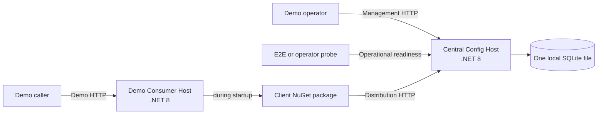
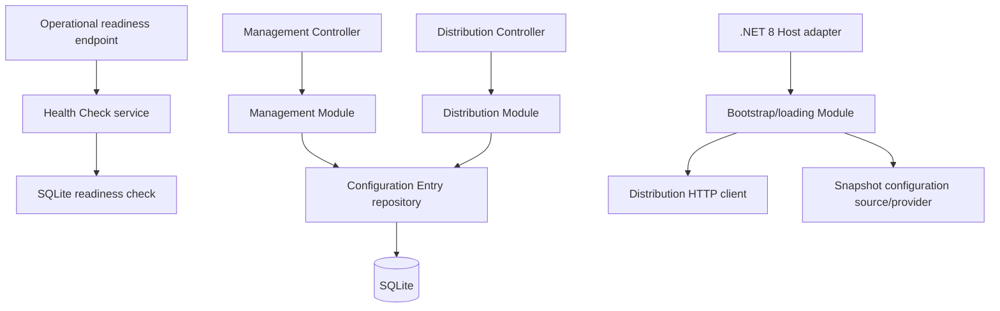

# 設定分發 POC 設計規格

> **審查狀態：** 已接受（Accepted）
>
> **目標：** 初始 .NET 8 POC
>
> **最後更新：** 2026-09-11
>
> **接受日期：** 2026-08-30

> **接受說明：** 完整設計與第 15 節的全部 14 項整合選擇已一併接受。POC-028、POC-049 與 POC-052 的技術修正已明確記錄於決策紀錄。

> **驗證釐清（2026-09-05）：** 已核准（Approved）的示範／E2E 階段保留實際程序的重試復原與最終啟動失敗證據，同時在可確定重現的用戶端測試接縫保留對呼叫端權杖取消及精確時序的斷言。這調整的是驗證責任歸屬，並未改變產品行為。

> **就緒狀態修訂（2026-09-11）：** 中央設定主機提供一個未加版本的維運就緒狀態介面 `GET /health/ready`，與管理介面及設定分發介面使用相同的程序與繫結。其安全契約與啟動關聯規則已於 POC-057 接受，詳見[中央就緒狀態探針與啟動識別值設計](central-readiness.md)。

本文件將已接受的 POC 決策整合成一份供實作使用的設計，描述將建置的系統。歷史替代方案及理由保留於 [POC 決策紀錄](../decisions/poc-decision-log.md)，標準術語則維持於 [`CONTEXT.md`](../../CONTEXT.md)。

此 POC 證明，共用的 `(Environment, Configuration Key)` 值只需集中管理一次，就能在應用程式啟動時透過 HTTP 取得並合併至 .NET 8 應用程式的一般設定管線，無須在伺服器登錄使用端。

## 1. 範圍與成功標準

此 POC 有三項交付成果：

1. **中央設定主機（Central Config Host）** — 使用單一個本機 SQLite 資料庫的 .NET 8 HTTP 服務，提供管理介面、設定分發介面與一個維運就緒狀態介面。
2. **用戶端套件（Client package）** — .NET 8 NuGet 套件，從設定分發介面載入所選的值，並將不可變的設定提供者插入使用端的啟動管線。
3. **示範使用端主機（Demo Consumer Host）** — 安裝此套件的 .NET 8 HTTP 服務，透過一個建議使用的限定範圍端點，以及一個明確標示為不安全的診斷端點，呈現最終合併的 `IConfiguration`。

工程師能完成下列事項時，即代表此 POC 成功：

- 建立設定項目的連續版本，包括值為空字串的版本；
- 查詢其目前狀態與完整歷程；
- 移除項目並於稍後還原，且不抹除歷程；
- 啟動示範使用端主機，在有效設定中觀察中央值、後備值及更高優先順序的本機值；
- 觀察中央必要設定鍵缺值時，以具型別且不洩漏設定值的診斷資訊使啟動失敗；
- 觀察允許後備設定鍵缺值時，本機設定提供者的結果仍然生效；
- 變更或移除中央值，並觀察執行中的使用端保留啟動快照，直到重新啟動；
- 執行下文定義的有界重試、逾時、取消、不區分大小寫、優先順序及錯誤契約驗證情境；以及
- 在使用管理介面作為獨立的業務介面證據之前，證明就緒狀態回應屬於自己持有的中央主機啟動。

## 2. 架構

系統包含兩個可執行程序與一個程序內套件：



管理介面、設定分發介面與維運就緒狀態介面各自獨立，因為它們服務不同的呼叫端，且具有不同語意。在此 POC 中，它們共用同一個中央設定主機程序、伺服器繫結、資料庫與部署。管理介面與設定分發介面以有版本的路由命名空間、控制器及應用模組區分；維運就緒狀態介面則是一個小型、未加版本的端點對應。這些介面不使用不同的連接埠或程序。

### 2.1 模組接縫



- 控制器負責轉接 HTTP 契約；控制器彼此不呼叫，也不包含領域或持久化政策。
- 管理模組負責 Set、Remove、目前狀態及歷程使用案例。
- 設定分發模組負責唯讀的批次 Resolve 使用案例。
- 健康模組接縫負責啟動識別值、標記為 ready 的 SQLite 檢查，以及安全的維運就緒狀態回應。它重用既有的 SQLite 初始化器，不新增主機或儲存抽象。
- 兩個中央模組共用相同的領域識別規則與持久化實作。
- 持久化接縫提供不可分割的 Set 與 Remove 儲存操作，以及唯讀的目前狀態、歷程與批次解析查詢。管理命令絕不由各自提交的 `GetLatest` 與 `Insert` 儲存庫呼叫組成。
- 用戶端套件將公開的 .NET 主機轉接器、載入政策、設定分發 HTTP 轉接器、診斷及不可變快照設定提供者分開。
- 示範主機僅依賴用戶端套件與其公開 API，絕不存取中央持久化層或套件的原始 HTTP 回應。

### 2.2 建議的方案配置

下列名稱與專案分拆描述實作配置，並非 HTTP 或 NuGet 相容性契約。資料夾或測試專案名稱可以變更，但須保留第 2.1 節的模組與可執程序式邊界。

```text
Demo.DotnetCore.ConfigService.sln
src/
  Demo.DotnetCore.ConfigService.CentralHost/
  Demo.DotnetCore.ConfigService.Client/
  Demo.DotnetCore.ConfigService.DemoHost/
tests/
  Demo.DotnetCore.ConfigService.CentralHost.Tests/
  Demo.DotnetCore.ConfigService.Client.Tests/
  Demo.DotnetCore.ConfigService.DemoHost.Tests/
  Demo.DotnetCore.ConfigService.EndToEnd.Tests/
docs/
  adr/
  decisions/
  demo/
  design/
  knowledge/
```

HTTP DTO 維持為各端私有，不放入共用的契約組件。HTTP 接縫由序列化契約測試與端對端測試保護。如此可避免未來的 .NET Framework 4.8 Receiver 耦合至 .NET 8 伺服器組件，同時讓傳輸契約保持明確。

## 3. 領域模型與不變條件

### 3.1 識別

**設定項目（Configuration Entry）** 以 `(Environment, Configuration Key)` 識別。

- 兩個組成部分都使用固定序位、不區分大小寫的識別方式。
- 單靠大小寫差異無法建立不同的項目或獨立的版本序列。
- 首次成功的 Set 決定該項目回傳時使用的顯示拼寫。
- 後續命令與查詢可以使用不同大小寫，但回傳儲存的顯示拼寫。
- 持久化層透過具名的 SQLite 自訂定序規則強制落實識別；其比較委派給 `StringComparer.OrdinalIgnoreCase`。SQLite 的預設比較與內建 `NOCASE` 定序規則不定義領域識別。
- 每個連線在任何陳述式參照結構描述之前，都會註冊此自訂定序規則。識別欄位宣告該定序規則，因此唯一條件約束與查詢述詞採用相同的比較方式。
- 首次插入的中央環境與設定鍵字串會保留為顯示拼寫；後續大小寫不同的輸入只作為查詢值，絕不覆寫它們。
- 用戶端套件在宣告與回應中直接使用 `StringComparer.OrdinalIgnoreCase`。

實作不得使用 `string.ToUpperInvariant()` 衍生二進位唯一鍵：不因文化特性而異的大寫轉換，無法保證在所有允許的 Unicode 中，都與固定序位、不區分大小寫的比較具有相同等價類別。已接受的自訂定序規則方案修正了 POC-028 先前要求另存正規化識別值的規定；決策紀錄保留此修訂歷程。

### 3.2 設定鍵結構

設定鍵（Configuration Key）：

- 不可為 null，且不可為空字串或只含空白；
- 開頭或結尾不得含有空白；
- 可以是單層，或使用 `:` 分層；
- 不得含有空字串或只含空白的區段；
- 第一個區段不得為 `CentralConfig`，判斷時不區分大小寫；以及
- 除上述限制外，可以包含 Unicode 與一般符號。

契約會拒絕的範例包括 `:Demo`、`Demo:`、`Demo::Message`、`Demo: :Message` 及 `CentralConfig:BaseAddress`。宣告中的 `__` 序列不會轉換為 `:`。

中央環境（Environment）不可為 null、空字串或只含空白，且開頭或結尾不得含有空白。它與 .NET 主機環境（Host Environment）彼此獨立。

### 3.3 項目版本與目前狀態

**項目版本（Entry Version）** 不可變，包含：

- 所屬的設定項目；
- 伺服器配置的有號 64 位元 `Version`；
- `Operation`，值為 `Set` 或 `Remove`；
- 可為 null 的 `Value`，Set 時不可為 null，Remove 時則為 null；以及
- 伺服器產生的 `CreatedAtUtc`。

版本號碼從 1 開始，僅在同一個項目內遞增。最大的版本號碼定義目前狀態；時間絕不用來定義順序。每次 Set 都附加一個版本，即使值與前一個版本相同亦然。使用溢位檢查的運算將 64 位元序列耗盡視為內部持久化失敗，不允許溢位回繞。

目前狀態為：

- 最新操作為 Set 時，狀態為 **Present**（存在）；或
- 最新操作為 Remove 時，狀態為 **Removed**（已移除）。

空字串是有效的 Present 值。移除（Removal）絕不以空字串或實體刪除表示。

Remove 遵循嚴格的狀態轉換：

| 先前狀態 | 結果 | 持久化效果 |
| --- | --- | --- |
| 從未存在 | `404 Not Found` | 無 |
| Present（存在） | `201 Created` | 附加 Remove 版本 |
| Removed（已移除） | `409 Conflict` | 無 |

Set 在任何先前狀態下都能成功，並附加下一個版本。所有版本在 POC 資料庫的存續期間內都會保留。

## 4. 中央設定主機 HTTP 介面

管理介面與設定分發介面的路由位於 `/api/v1` 下。控制器使用 `System.Text.Json`；JSON 成員名稱採用小駝峰命名，契約列舉值如 `Present`、`Removed`、`Set` 及 `Remove` 會序列化為所示字串，而非數字。未知的要求屬性會遭拒絕。成功回應的時間戳記為 UTC `DateTimeOffset` 值，以預設的 System.Text.Json ISO 8601 格式序列化。伺服器持有的 `TimeProvider` 提供時間，以支援可確定重現的測試。維運就緒狀態介面是第 4.6 節的單一未加版本路由。

### 4.1 管理介面：Set

`POST /api/v1/management/configurations/set`

要求：

```json
{
  "environment": "UAT",
  "key": "Demo:Message",
  "value": "central-value"
}
```

`value` 為必要欄位，且不可為 null。`""` 是有效值。其 UTF-8 編碼大小最多可為 16 KiB（16,384 位元組），包含上限值。

成功：`201 Created`

```json
{
  "environment": "UAT",
  "key": "Demo:Message",
  "version": 1,
  "state": "Present",
  "createdAtUtc": "2026-08-30T07:00:00+00:00"
}
```

命令回應刻意不回傳設定值。此 POC 不要求 `Location` 標頭，因為建立的資源是歷史命令結果，而非由單一穩定版本資源路由回傳的表示內容。

### 4.2 管理介面：Remove

`POST /api/v1/management/configurations/remove`

要求：

```json
{
  "environment": "uat",
  "key": "demo:message"
}
```

要求契約沒有 `value` 成員；傳送此成員會造成未知屬性驗證錯誤。

成功：`201 Created`

```json
{
  "environment": "UAT",
  "key": "Demo:Message",
  "version": 2,
  "state": "Removed",
  "createdAtUtc": "2026-08-30T07:05:00+00:00"
}
```

從未建立與已移除的結果遵循第 3.3 節的嚴格狀態轉換表。

### 4.3 管理介面：目前狀態

`GET /api/v1/management/configurations/current?environment=UAT&key=Demo%3AMessage`

Present 回應：`200 OK`

```json
{
  "environment": "UAT",
  "key": "Demo:Message",
  "version": 1,
  "state": "Present",
  "value": "central-value",
  "createdAtUtc": "2026-08-30T07:00:00+00:00"
}
```

Removed 回應：`200 OK`，含有 `"state": "Removed"` 與 `"value": null`。從未建立的項目回傳 `404 Not Found`。

### 4.4 管理介面：歷程

`GET /api/v1/management/configurations/history?environment=UAT&key=Demo%3AMessage`

成功：`200 OK`

```json
{
  "environment": "UAT",
  "key": "Demo:Message",
  "versions": [
    {
      "version": 2,
      "operation": "Remove",
      "value": null,
      "createdAtUtc": "2026-08-30T07:05:00+00:00"
    },
    {
      "version": 1,
      "operation": "Set",
      "value": "central-value",
      "createdAtUtc": "2026-08-30T07:00:00+00:00"
    }
  ]
}
```

版本以遞減順序排列。此 POC 的歷程不分頁。從未建立的項目回傳 `404 Not Found`。

### 4.5 設定分發介面：Resolve

`POST /api/v1/distribution/configurations/resolve`

要求：

```json
{
  "environment": "uat",
  "keys": [
    "demo:message",
    "Demo:LocalFallback"
  ]
}
```

`keys` 必須是非空陣列。null、空字串或只含空白、結構無效、使用保留根節點，以及不區分大小寫後重複的設定鍵都會遭拒絕。

成功：`200 OK`

```json
{
  "values": {
    "Demo:Message": "central-value"
  },
  "missingKeys": [
    "Demo:LocalFallback"
  ]
}
```

這兩個集合須在不區分大小寫的比較下，精確分割要求中相異的設定鍵：

- 存在的項目在 `values` 中出現一次，包括值為空字串的項目；
- 已移除的項目以儲存的顯示拼寫出現在 `missingKeys`；
- 從未建立的項目以要求中的拼寫出現在 `missingKeys`；
- 不回傳未要求的設定鍵、null 值、版本、時間戳記、使用端識別、缺值行為（Missing Behavior）或 `removedKeys`。

缺少的設定鍵（Missing Key）不會使 Resolve 失敗。用戶端套件在驗證完整回應之後，才決定必要或後備行為。

### 4.6 維運就緒狀態

`GET /health/ready`

這是唯一的維運就緒狀態介面。它位於 `/api/v1` 之外、不使用控制器，且只執行標記為 ready 的 SQLite 健康檢查。已完成的 `Healthy` 報告回傳 `200 OK`；已完成的 `Degraded` 或 `Unhealthy` 報告回傳 `503 Service Unavailable`。兩種回應均使用 `application/json`、`Cache-Control: no-store`，且恰好包含 `status` 與 `instanceId`：

```json
{
  "status": "ready",
  "instanceId": "794c1ca58c1342a6863d81e152777b17"
}
```

`200` 回應的 `status` 值為 `ready`；`503` 回應的值為 `unavailable`。`instanceId` 是以單次啟動為範圍、不可變的 `N` 格式小寫 GUID。所有就緒狀態回應都不暴露健康檢查項目、持久化細節、設定資料、例外或堆疊追蹤。這不是 Problem Details 回應。不新增存活狀態或啟動路由。

## 5. HTTP 驗證與錯誤

### 5.1 驗證邊界

中央主機使用 FluentValidation 12，對反序列化後的要求 DTO 進行語意驗證。驗證器登錄為 `IValidator<TRequest>`，每個控制器都會在進入模組前明確等待 `ValidateAsync`。

- 獨立欄位持續驗證，讓單一回應能包含所有可獨立偵測的失敗。
- 相依規則在前置條件失敗後停止，避免重複訊息及不安全的操作，例如測量 null 值。
- FluentValidation 不執行持久化查詢。
- 以 ASP.NET Core 與 System.Text.Json 建置的共用傳輸驗證元件，在語意驗證前處理缺少本文、JSON 格式錯誤、不相容的權杖型別及未知屬性。它將每個要求物件的最上層成員與所選 DTO 的允許成員集合比較，絕不透過解析 `JsonException.Message` 來分類未知成員。
- 無效要求絕不進入應用模組或持久化層。

設定值的限制只以具名常數宣告一次，例如 `MaxConfigurationValueUtf8Bytes = 16 * 1024`，並附上簡潔的理由註解及 POC-050 參照。反序列化後使用 `Encoding.UTF8.GetByteCount(value)` 測量。

不為中央環境、設定鍵、設定鍵數量、合計承載資料、要求本文或回應本文新增其他由應用程式定義的數值大小限制。主控環境、閘道、序列化器、HTTP 用戶端、SQLite 與記憶體的限制仍然適用，但不屬於此 POC 契約。

### 5.2 Problem Details 契約

在選定已定義的端點後、HTTP 回應開始前產生的所有已知管理或設定分發失敗，都使用 `application/problem+json` 與 RFC 9457 Problem Details。中央主機的單一錯誤對應元件整合傳輸／模型狀態對應、`IProblemDetailsService` 及例外處理，負責這些回應；控制器不各自建立無關的錯誤本文。維運就緒狀態介面使用第 4.6 節獨立且安全的彙總回應。

```json
{
  "type": "about:blank",
  "title": "Bad Request",
  "status": 400,
  "detail": "One or more request fields are invalid.",
  "instance": "/api/v1/management/configurations/set",
  "code": "validation_failed",
  "traceId": "00-...",
  "errors": [
    {
      "path": "key",
      "code": "invalid_configuration_key",
      "message": "Configuration Key has an invalid structure."
    }
  ]
}
```

此契約涵蓋的每個回應：

- `type` 恰為 `about:blank`；
- `title` 為實際 HTTP 狀態的標準原因片語；
- 數值 `status` 與 HTTP 回應狀態完全相等；
- `instance` 為不含查詢字串的要求路徑；
- `code` 為中央主機定義的穩定 snake_case 機器識別碼；
- `traceId` 將回應與伺服器端日誌建立關聯；以及
- `detail` 為固定且安全的英文文字。

用戶端依 HTTP 狀態及 `code` 判斷分支，絕不依人類可讀欄位判斷。

| HTTP 狀態 | `code` | 意義 |
| --- | --- | --- |
| 400 | `validation_failed` | 要求的傳輸或語意驗證失敗 |
| 404 | `configuration_not_found` | 項目從未存在 |
| 409 | `configuration_already_removed` | Remove 的目標是已移除的項目 |
| 503 | `persistence_busy` | SQLite 在有界等待後仍處於忙碌狀態 |
| 500 | `persistence_failure` | Locked 結果或已知的持久化實作失敗 |
| 500 | `internal_error` | 非預期的應用程式失敗 |

只有 `validation_failed` 含有 `errors` 陣列。陣列順序不屬於契約。每個項目都有穩定的 `path` 與 `code` 識別碼，以及固定且安全的 `message`。傳輸對應如下：

| 條件 | 路徑 | 代碼 |
| --- | --- | --- |
| 缺少本文 | `$` | `body_required` |
| JSON 格式錯誤 | `$` | `invalid_json` |
| 不相容的權杖 | 安全的 JSON 路徑 | `invalid_type` |
| 未知屬性 | `$` | `unknown_property` |

此契約不暴露原始輸入、未知屬性名稱、剖析器訊息、例外訊息、設定值、SQL、路徑、連線字串、堆疊追蹤或查詢字串。`persistence_busy` 沒有 `Retry-After` 標頭。端點選定前發生的路由、方法、Proxy、Kestrel 及網路錯誤不在此保證範圍內。回應序列化已開始後發生的失敗也無法改寫為此契約；此類失敗會中止回應，並由伺服器端診斷涵蓋。

## 6. SQLite 持久化

### 6.1 POC 拓撲與存取

此 POC 恰好執行一個中央設定主機執行個體，使用恰好一個本機 SQLite 檔案。不支援多個主機執行個體、共用網路儲存、複寫、容錯移轉、多個中央來源或多個資料庫檔案。

主機使用 Dapper 與 `Microsoft.Data.Sqlite`，並明確撰寫 SQL，不使用 Entity Framework Core。連線為短生命週期，每次操作個別建立；儲存庫方法負責各自的連線與交易邊界。

主機讀取一個必要的本機連線字串 `ConnectionStrings:CentralConfigDatabase`。納入版控的示範值為 `Data Source=central-config.db`；整合測試會將它替換為隔離的暫存檔案路徑。相對的 `Data Source` 以 `IHostEnvironment.ContentRootPath` 為基準解析，主機會在啟動時建立其直接父目錄。連線字串缺少或空白、Data Source 缺少或空白，或路徑無效，都會使主機啟動失敗。資料庫路徑與完整連線字串絕不出現在 HTTP 錯誤中。

資料庫初始化在主機開始處理要求之前進行：

1. 開啟通往已設定本機資料庫檔案的連線。
2. 為初始化連線啟用外部索引鍵。
3. 執行 `PRAGMA journal_mode=WAL`，並驗證回傳的有效模式為 `wal`；否則使主機啟動失敗。
4. 讀取 `PRAGMA user_version`。若為版本 0 且沒有 POC 資料表，則在單一 DDL 交易中初始化結構描述版本 1。若為版本 1，則驗證必要的資料表、欄位、索引及以定序規則支援的唯一性。任何其他版本或不相容的部分結構描述，都會使主機啟動失敗。
5. 使用 SQLite 的自動檢查點行為；不新增檢查點服務或調校介面。

每個開啟的連線都會註冊固定序位、不區分大小寫的定序規則、啟用外部索引鍵強制檢查，並設定 `Default Timeout=5`；這些行為以連線為範圍。`Microsoft.Data.Sqlite` 將此有界逾時套用至命令及交易取得。應用程式不在此提供者之上再加一層持久化重試迴圈。

標記為 ready 的檢查會開啟已設定的資料庫，並透過既有的連線與清理流程執行唯讀的結構描述 v1 驗證。它使用相同的五秒逾時，不執行任何寫入 SQL。

### 6.2 邏輯結構描述

此結構描述將穩定的項目識別及顯示拼寫，與不可變的版本分開：

```sql
CREATE TABLE ConfigurationEntries (
    Id               INTEGER PRIMARY KEY,
    Environment      TEXT NOT NULL COLLATE ORDINAL_IGNORE_CASE,
    ConfigurationKey TEXT NOT NULL COLLATE ORDINAL_IGNORE_CASE,
    CONSTRAINT UQ_ConfigurationEntries_Identity
        UNIQUE (Environment, ConfigurationKey)
);

CREATE TABLE ConfigurationEntryVersions (
    Id                   INTEGER PRIMARY KEY,
    ConfigurationEntryId INTEGER NOT NULL,
    Version              INTEGER NOT NULL CHECK (Version >= 1),
    Operation            TEXT NOT NULL CHECK (Operation IN ('Set', 'Remove')),
    Value                TEXT NULL,
    CreatedAtUtc         TEXT NOT NULL,
    CONSTRAINT FK_ConfigurationEntryVersions_Entry
        FOREIGN KEY (ConfigurationEntryId)
        REFERENCES ConfigurationEntries (Id),
    CONSTRAINT UQ_ConfigurationEntryVersions_Version
        UNIQUE (ConfigurationEntryId, Version),
    CONSTRAINT CK_ConfigurationEntryVersions_Value
        CHECK (
            (Operation = 'Set' AND Value IS NOT NULL) OR
            (Operation = 'Remove' AND Value IS NULL)
        )
);

CREATE INDEX IX_ConfigurationEntryVersions_Latest
    ON ConfigurationEntryVersions (ConfigurationEntryId, Version DESC);
```

上述 SQL 為 POC 的邏輯結構描述；實作可以調整引號或 DDL 的組織方式，但不得改變條件約束。`ORDINAL_IGNORE_CASE` 是第 3.1 節所述、在連線上註冊的定序規則。UTC 時間戳記使用可往返轉換的 ISO 8601 文字表示。版本 1 之後的結構描述移轉已延後（Deferred）；既有結構描述若不相容，啟動即失敗，不會猜測或悄悄改寫。

### 6.3 寫入交易與順序

每個不可分割的 Set 與 Remove 儲存操作都負責一個明確的 `BEGIN IMMEDIATE` 交易，使用 Microsoft.Data.Sqlite 的立即交易 API 建立（例如 `connection.BeginTransaction(deferred: false)`），並傳入每個 Dapper 命令：

1. 取得 SQLite 寫入交易。
2. 依命令允許的行為，解析或建立由定序規則支援的項目識別。
3. 在該交易內讀取最新已提交版本。
4. 驗證狀態轉換。
5. 配置 `checked(latestVersion + 1)`；首次 Set 則配置 1。
6. 插入恰好一個不可變版本。
7. 提交。

提交前的失敗會回復交易、不附加任何資料，也不消耗版本號碼。成功取得寫入交易的順序決定可觀察的命令順序；HTTP 抵達、進入控制器、工作排程或回應完成的順序都不決定命令順序。

由此產生的結果包括：

- 同一項目的並行 Set 可以皆成功，並取得連續版本；
- 對 Present 項目的兩個並行 Remove 會得到一次成功，接著一次 `409`；
- 並行 Set 與 Remove 命令會觀察前一個已提交交易留下的狀態；
- 不同項目的寫入因 SQLite 的單一寫入者行為而暫時依序執行；以及
- 讀取可觀察提交前或提交後的完整狀態，絕不觀察到部分命令結果。

### 6.4 SQLite 失敗

- 最終的 `SQLITE_BUSY`，包括延伸 busy 代碼，對應至 `503 persistence_busy`。
- 最終的 `SQLITE_LOCKED`，包括延伸 locked 代碼，在伺服器端記錄為 Error，並對應至 `500 persistence_failure`。
- 其他已知的持久化實作失敗對應至 `500 persistence_failure`。
- 非預期的應用程式失敗對應至 `500 internal_error`。

這兩種 SQLite 結果都沒有應用程式層級的重試。`Microsoft.Data.Sqlite` 可能在操作處於 busy 或 locked 時套用共用的五秒 `Default Timeout`，之後才回傳最終結果。已接受的設計修正了 POC-049 先前假設提供者可以對 Busy 等待、但對 Locked 立即回傳的說法；此公開提供者沒有為這些結果類別提供獨立的等待政策，決策紀錄保留此修訂歷程。

原始 SQLite 診斷保留在伺服器端，絕不複製至 HTTP 回應。中央主機的 Error 日誌記錄完整例外（訊息、堆疊追蹤與內層例外），並以 `traceId` 與 Problem Details 回應關聯；就緒狀態檢查失敗的例外只進入健康檢查日誌，不出現在就緒狀態回應；資料庫初始化失敗會保留原始例外作為 `InnerException`，只輸出至操作者主控台。為了讓完整例外不夾帶設定值，中央主機自己的例外訊息一律是固定文字，不組合設定值、要求內容或其他執行期資料；慣例測試掃描中央主機原始碼，拒絕以字串插值、`string.Format` 或字串串接建立例外訊息。要求主體與查詢字串不寫入日誌。作用中的 `-wal` 與 `-shm` 附屬檔案屬於預期行為，主機執行時不得刪除。

就緒狀態介面將每個已完成的相依項目失敗，對應至安全的彙總 `503 unavailable` 回應，而非管理介面或設定分發介面的持久化 Problem Details 回應。

## 7. 用戶端套件公開契約

### 7.1 登錄 API

套件恰好提供下列 .NET 8 登錄多載：

```csharp
public static Task AddCentralConfigAsync(
    this IHostApplicationBuilder builder,
    CancellationToken cancellationToken = default);

public static Task AddCentralConfigAsync(
    this IHostApplicationBuilder builder,
    ILogger startupLogger,
    CancellationToken cancellationToken = default);
```

使用端在 `WebApplication.CreateBuilder(args)` 或 `Host.CreateApplicationBuilder(args)` 之後、`Build()` 之前，恰好呼叫並等待其中一個多載一次。

此 POC 的套件不提供同步多載、公開的設定提供者索引、`ConfigurationManager` 多載、公開的傳輸轉接器、選項委派、路由覆寫、重試設定或放置位置設定。

### 7.2 使用端宣告

支援的基礎 `appsettings.json` 形狀如下：

```json
{
  "CentralConfig": {
    "Enabled": true,
    "BaseAddress": "https://internal.example/config-center/",
    "Environment": "UAT",
    "CentralRequiredKeys": [
      "Demo:CentralRequiredMessage"
    ],
    "FallbackAllowedKeys": [
      "Demo:FallbackAllowedMessage"
    ]
  }
}
```

登錄套件時，`Enabled` 必須始終明確存在，且可解析為布林值。

`Enabled` 為 false 時：

- 不驗證 `BaseAddress`、`Environment` 與兩個陣列；
- 不傳送 HTTP 要求；
- 不插入中央來源或設定提供者；以及
- 本機設定提供者維持正常行為。

`Enabled` 為 true 時：

- `BaseAddress` 與 `Environment` 為必要欄位，且在網路存取前驗證；
- 兩個陣列正規化為一個內部的設定鍵選擇（Key Selection）；
- 每個設定鍵依其來源陣列，取得恰好一種缺值行為；
- 以不區分大小寫的方式拒絕陣列內重複值，以及陣列間重疊值；
- 每個設定鍵都遵循第 3.2 節的結構規則；以及
- 合併後的選擇必須包含至少一個設定鍵。

伺服器只接收去除重複後的設定鍵聯集，絕不接收使用端識別或缺值行為，也不儲存使用端登錄資料。

用戶端啟動設定與設定鍵選擇驗證屬於套件內部實作。用戶端套件既不參照 FluentValidation，也不公開 FluentValidation 型別；FluentValidation 12 僅為中央主機 HTTP 邊界的相依套件。

這兩個陣列僅支援在基礎 `appsettings.json` 中宣告。套件接收 .NET 已合併的 `IConfiguration`、正規化有效陣列，且不檢查設定提供者的來源。因此，只要合併結果在其他方面仍然有效，較高優先順序的索引式陣列來源仍可改變有效選擇，且不會產生特別警告。這是文件明訂的不支援用法，並非執行階段防護。詳見 [.NET Configuration 的陣列與多 Provider 合併行為](../knowledge/dotnet-configuration-array-merging.md)。

其他啟動設定欄位（`Enabled`、`BaseAddress` 及 `Environment`）可以來自一般的較高優先順序本機來源。每個 `CentralConfig:*` 設定鍵都是保留項目，不能被選取，也不能由中央設定提供者提供。

### 7.3 中央環境與端點

`CentralConfig:Environment` 必須明確指定，且與 `IHostEnvironment.EnvironmentName` 彼此獨立。套件絕不從其中一者推導另一者，也不以另一者作為預設值。

`CentralConfig:BaseAddress` 必須是包含主機的絕對 HTTP 或 HTTPS URI。允許連接埠與閘道路徑前綴；拒絕查詢字串、片段及內嵌使用者資訊。套件將設定的路徑正規化為恰好一個尾端斜線，並附加由套件定義的相對路由：

```text
api/v1/distribution/configurations/resolve
```

例如：

```text
BaseAddress: https://internal.example/config-center
Resolved:    https://internal.example/config-center/api/v1/distribution/configurations/resolve
```

使用端設定不能替換此路由。此 POC 允許 HTTP 與 HTTPS，不定義任何認證資訊。

## 8. 用戶端載入行為

### 8.1 啟動順序

啟用時，`AddCentralConfigAsync` 執行下列順序：

1. 讀取並驗證本機啟動設定。
2. 將兩個陣列正規化為一個不區分大小寫的設定鍵選擇。
3. 在目前設定管線中，找出唯一且無歧義的標準 `appsettings.{HostEnvironment}.json` 來源。
4. 解析設定分發端點。
5. 在重試與逾時政策下取得一個批次回應。
6. 驗證回應是否精確分割要求中的設定鍵。
7. 若任何中央必要設定鍵（Central-Required Key）缺值，則失敗。
8. 建立僅含回傳中央值的不可變字典。
9. 將快照來源插入至環境專屬 JSON 來源的緊接後方。
10. 成功回傳；快照設定提供者的同步 `Load` 不執行任何 I/O。

所有可在本機執行的驗證都在網路存取前完成。取得作業完成後才變更設定管線，因此失敗的呼叫不會留下部分安裝的中央來源。

### 8.2 回應信任邊界

只有 HTTP `200 OK` 是成功的 Resolve 狀態。在具型別的對應之前，用戶端先剖析原始 JSON 物件並驗證成員結構，避免重複的 JSON 屬性在字典反序列化時被悄悄合併。最上層成員名稱以不區分大小寫的方式，比對必要的 `values` 與 `missingKeys` 名稱；兩者都必須恰好出現一次，所有未知的最上層成員都會遭拒絕。在建立字典前先列舉 `values` 內的屬性，以拒絕大小寫不同的重複設定鍵。

`200 OK` 回應符合下列任何情況時，套件會將其視為無效而拒絕：

- 無法反序列化為預期的版本化 DTO 形狀；
- 包含 null 值或 UTF-8 大小超過 16 KiB 的值；
- 包含未要求的設定鍵；
- 要求中的某個設定鍵在兩個集合中都未出現；
- 以不區分大小寫的比較判斷，相同設定鍵出現超過一次，或同時出現在兩個集合；
- 無法精確分割要求中相異的設定鍵；或
- 違反設定鍵結構規則。

空字串值會被接受。回傳及缺少的設定鍵可以與要求使用不同大小寫，但以固定序位、不區分大小寫的語意比對。有效回應中缺少的允許後備設定鍵（Fallback-Allowed Key）不提供任何中央值；套件不檢查其他設定提供者是否提供該值。有效回應中缺少的中央必要設定鍵，即使存在本機值，也會使啟動失敗。

### 8.3 重試、逾時與 HTTP 分類

每次載入具有下列由套件定義的固定限制：

| 政策項目 | 值 |
| --- | --- |
| 嘗試次數 | 一次初始嘗試，加上最多三次重試 |
| 每次嘗試逾時 | 5 秒 |
| 重試延遲 | 1、2 與 4 秒 |
| 隨機抖動 | 每次延遲獨立產生 0–250 ms |
| 整體取得時間預算 | 30 秒，包含嘗試與延遲 |

僅在下列情況重試：

- 傳輸失敗；
- 套件定義的單次嘗試逾時；以及
- HTTP `408`、`429`、`500`、`502`、`503` 或 `504`。

下列情況不重試：

- 無效的本機啟動設定或設定管線；
- 呼叫端要求取消；
- HTTP `400`、`401`、`403`、`404`，或任何上文未列出的狀態；
- 無效或不可信的 `2xx` 回應；或
- 有效回應中缺少中央必要設定鍵。

Resolve 是沒有副作用的唯讀 POST，因此可以安全重試。伺服器提供的延遲不會延長或取代套件排程。成功後立即停止；30 秒時間預算到期即失敗，即使名義上還有剩餘嘗試次數亦然。

僅供測試的接縫可以替換 HTTP 轉接器、時間、延遲及隨機抖動來源，但不將它們公開為使用端設定。

### 8.4 設定提供者放置位置與生命週期

支援的有效順序由低至高如下：

1. `appsettings.json`
2. `appsettings.{HostEnvironment}.json`
3. 中央啟動快照
4. 使用者秘密（User Secrets）
5. 環境變數（Environment Variables）
6. 命令列引數

主機轉接器將中央來源插入至唯一標準環境專屬 JSON 來源的緊接後方，不會附加至最後。既有自訂來源保留其相對於插入位置的實體關係；登錄後附加的任何來源都具有更高優先順序。

若無法識別唯一的標準環境 JSON 錨點，登錄會失敗，不會猜測。在具型別的失敗契約中，此情況分類為 `InvalidConfigurationPipeline`。

中央設定提供者（Provider）是不可變的啟動快照。它不執行輪詢、更新、推播訂閱、重新載入權杖更新，或最後已知良好設定的持久化。中央的 Set 或 Remove 只有在使用端重新啟動後才會可見。

「不可變」指快照內容不會再與中央同步。程式內透過 `IConfiguration[key] = value` 的寫入（例如 `WebHost.UseUrls`、`UseSetting`）會呼叫每個設定提供者的 `Set`；快照設定提供者沿用 .NET 預設的記憶體內行為接受此寫入，不拋出例外，也不影響中央值或其他由同一來源建立的提供者。

## 9. 用戶端診斷與取消

### 9.1 具型別的最終失敗

每個由套件定義的最終啟動失敗，都以一個公開的 `CentralConfigLoadException` 呈現。其公開診斷資料不包含設定值或原始遠端內容，在此 POC 中具有下列形狀：

```csharp
public enum CentralConfigFailureKind
{
    InvalidBootstrapConfiguration,
    InvalidConfigurationPipeline,
    TransportFailure,
    AttemptTimeout,
    TotalTimeout,
    Unauthorized,
    HttpFailure,
    InvalidResponse,
    MissingRequiredKeys
}
```

```csharp
public sealed class CentralConfigLoadException : Exception
{
    public CentralConfigFailureKind FailureKind { get; }
    public int AttemptCount { get; }
    public TimeSpan Elapsed { get; }
    public HttpStatusCode? HttpStatusCode { get; }
    public string? Environment { get; }
    public IReadOnlyList<string> MissingRequiredKeys { get; }
    public string? CentralErrorCode { get; }
    public string? CentralTraceId { get; }
}
```

確切的建構函式由套件定義。HTTP 嘗試之前發生失敗時，`AttemptCount` 為零；其他情況則記錄已完成或最終失敗的嘗試次數。`Elapsed` 是從進入登錄方法至最終分類的單調時間長度。除非 HTTP 回應決定了最終失敗，否則 `HttpStatusCode` 為 null；除非已解析出有效的中央環境，否則 `Environment` 為 null。`MissingRequiredKeys` 是不可為 null 的唯讀清單，只在對應的失敗種類下包含依宣告順序排列、去除重複的使用端宣告拼寫；其他情況則為空清單。例外訊息是依 `FailureKind` 決定的固定安全文字，絕不包含設定值、本文、原始剖析器訊息或原始中央錯誤細節。

`CentralErrorCode` 與 `CentralTraceId` 只在最終的非 `200` HTTP 回應決定失敗（`Unauthorized` 或 `HttpFailure`）時才可能有值，來自該次回應的 Problem Details。用戶端只在回應的媒體類型為 `application/problem+json` 時讀取非 `200` 本文，且只取出 `code` 與 `traceId` 兩個字串：`code` 必須符合 `^[a-z][a-z0-9_]{0,63}$`，`traceId` 必須是 W3C traceparent 或 ASP.NET Core 的 `TraceIdentifier` 格式（比對以字串結尾為界，不接受結尾換行）。不符合格式的欄位視為不存在，其他成員一律忽略，原始本文不離開 HTTP 轉接器；讀取失敗也不改變依 HTTP 狀態決定的分類與重試。這兩個值是中央產生的識別碼，不是原始中央錯誤文字，讓使用端可以用 `traceId` 對應中央主機日誌中的同一筆記錄。

POC 失敗對應如下：

| 結果 | 失敗種類 |
| --- | --- |
| 本機設定或設定鍵選擇無效／缺少 | `InvalidBootstrapConfiguration` |
| 設定提供者插入錨點缺少或有歧義 | `InvalidConfigurationPipeline` |
| 重試後仍傳輸失敗 | `TransportFailure` |
| 總時間預算到期前，發生最終單次嘗試逾時 | `AttemptTimeout` |
| 整體取得時間預算到期 | `TotalTimeout` |
| HTTP 401 或 403 | `Unauthorized` |
| 其他最終的非成功 HTTP 狀態 | `HttpFailure` |
| 不可信的成功回應 | `InvalidResponse` |
| 有效回應中缺少必要設定鍵 | `MissingRequiredKeys` |

若呼叫端與套件逾時權杖都未要求取消，卻發生非預期的下游 `OperationCanceledException`，則視為 `TransportFailure`，不會誤標為呼叫端取消。為使 POC 診斷邊界可供審查，不保留任意下游例外作為 `InnerException`。伺服器與用戶端套件測試會驗證，此作法仍保留診斷所需的安全結構化內容。

### 9.2 呼叫端取消

呼叫端要求的取消屬於控制流程，不是中央失敗：

- 回傳的 Task 以 Canceled（已取消）狀態完成；
- 等待該 Task 會擲出與原始呼叫端權杖關聯的 `OperationCanceledException`；
- 作用中的嘗試或延遲停止；
- 不再排程重試；
- 不發出由套件定義的最終 Error 日誌；以及
- 不以 `CentralConfigLoadException` 包裝取消。

分類會檢查原始呼叫端權杖，以及套件持有的單次嘗試與總時間預算權杖。若在分類時有多個取消來源已提出要求，優先順序為 `Caller cancellation` → `TotalTimeout` → `AttemptTimeout` → 非預期的下游取消。若套件失敗已先完成，之後才發生取消，不會追溯改變失敗結果。底層 HTTP 用戶端停用內建逾時，因此只有這些可區分、由套件持有的權杖定義逾時行為；連結權杖涵蓋回應標頭與本文讀取。

### 9.3 啟動日誌

含有 `ILogger startupLogger` 的多載，讓呼叫端提供 `Build()` 前的診斷。呼叫端負責其建立、設定、輸出、生命週期與處置。套件不建立 `LoggerFactory`、設定日誌提供者、建置暫時服務提供者、直接寫入 Console，或安裝隱藏的後備日誌記錄器。基礎多載不保證 `Build()` 前的日誌傳遞或重播。

提供啟動日誌記錄器時，套件會嘗試發出下列結構化且不洩漏設定值的日誌：

- 成功載入後發出一次 Information 摘要，包含數量、嘗試次數與經過時間；
- 每次排程重試時發出一次 Warning，包含嘗試次數、安全分類、選擇性的狀態、延遲，以及該次回應可為 null 的 `CentralErrorCode` 與 `CentralTraceId`；以及
- 在擲出最終 `CentralConfigLoadException` 前，立即發出一次 Error。

最終 Error 只嘗試發出一次。主機可能再次記錄隨後擲出的例外；此可能發生的重複已被接受。

套件發起的每次日誌記錄器呼叫，包括 `IsEnabled`，都經過同一個盡力而為的安全輸出接縫，以隔離可攔截的同步日誌記錄器例外。日誌記錄器失敗絕不改變載入、重試、取消、設定提供者插入，或最終擲出的例外。此失敗不會重試、遞迴記錄、暴露於公開例外，或傳送至其他輸出。詳見[呼叫端提供的啟動 Logger](../knowledge/caller-supplied-startup-logger.md)。

缺少的中央必要設定鍵名稱，以及第 9.1 節驗證過的 `CentralErrorCode` 與 `CentralTraceId`，可以出現在具型別例外及最終 Error 日誌中。重試 Warning 也帶出這兩個欄位，值取自觸發該次重試的 HTTP 回應，並經過相同的格式驗證；傳輸失敗、逾時或回應沒有可用的 Problem Details 時，兩者為 null。一次啟動在中央留下的每筆 Error 日誌，因此都能以 `traceId` 對應到使用端的一筆 Warning 或最終 Error。成功的設定鍵與缺少的允許後備設定鍵只以數量摘要呈現。設定值、連線字串、認證資訊、授權標頭、權杖、Cookie、本文、原始中央文字，以及未經審查的剖析器或例外訊息，絕不進入套件例外或日誌。

## 10. 示範使用端主機

示範主機是一般的 .NET 8 Web API，在啟動期間登錄用戶端套件。它只包含非敏感的示範設定，展示最終有效設定，不展示設定提供者來源或原始設定分發回應。

### 10.1 建議使用的限定範圍端點

`GET /api/v1/demo/effective-configuration`

此端點列舉固定 `Demo:*` 區段下每個非 null 的設定值，並回傳相對於 `Demo:` 的路徑：

```json
{
  "scope": "Demo",
  "effectiveValues": {
    "CentralRequiredMessage": "central-value",
    "FallbackAllowedMessage": "local-fallback",
    "Features:0": "FeatureA"
  }
}
```

空字串會保留。值為 null 的分組節點會略去。若區段沒有非 null 值，`effectiveValues` 為 `{}`。屬性順序不屬於契約。

### 10.2 不安全的根設定端點

`GET /api/v1/demo/unsafe/root-configuration`

此端點刻意從最終根 `IConfiguration` 列舉每個非 null 的設定值：

```json
{
  "scope": "Root",
  "warning": "This response may expose sensitive configuration values.",
  "effectiveValues": {
    "CentralConfig:Enabled": "true",
    "Demo:CentralRequiredMessage": "central-value"
  }
}
```

此端點可能暴露本機 JSON 值、啟動設定、使用者秘密、環境變數、命令列值、連線字串或其他程序設定。它始終建立路由對應，且沒有功能旗標、驗證、遮蔽或主機環境防護。`unsafe` 路由區段、警告及文件傳達風險；由操作者決定是否呼叫。

兩個示範端點皆：

- 回傳 `200 OK`，使用 `application/json`；
- 使用 `Cache-Control: no-store`；
- 只讀取最終合併的 `IConfiguration`；
- 不在處理要求時呼叫中央主機；
- 不暴露設定提供者來源或項目版本中繼資料；以及
- 不記錄回傳的設定鍵或設定值。

<a id="11-security-and-resource-boundary"></a>

## 11. 安全性與資源邊界

此 POC 刻意不實作身分驗證、授權、呼叫端識別、認證資訊、個別介面權限、強制 TLS 或憑證政策。任何能連線至中央主機的呼叫端都可以管理及讀取設定值。它不具備正式環境所需的安全性，必須在適當隔離的示範環境中使用非敏感的示範資料。

相同限制也適用於示範主機，尤其是根設定端點。即使安全控制不在範圍內，不洩漏設定值的用戶端診斷與中央錯誤回應仍是必要要求。

中央主機在啟動時擷取一次 `CentralHealth:InstanceId`。它是用於啟動歸屬的非敏感關聯值，不是秘密、認證資訊、身分驗證輸入、授權權杖或密碼學證明。若缺少此值，會產生一個 `N` 格式的小寫 GUID；若設定值不符合標準格式，則在主機開始接聽前失敗。此值在該程序內不可變。

此 POC 唯一定義的數值承載資料邊界，是每個設定值的 UTF-8 大小上限 16 KiB。在完成具代表性的應用程式盤點之前，合計限制沿用框架與部署的預設值。若未來評估於正式環境採用此方案，其設計必須依據實際量測的設定鍵數量、設定鍵與中央環境長度、要求／回應合計大小、設定值分布、啟動時間與記憶體，以及實際閘道／主控環境限制。詳見 [HTTP、ASP.NET Core 8、System.Text.Json 與 HttpClient 的大小限制筆記](../knowledge/dotnet-http-size-limits.md)。

## 12. 驗證策略

測試依穩定介面與行為組織，不依私有實作細節組織。

### 12.1 中央主機測試

- 領域與驗證單元測試涵蓋識別、設定鍵結構、保留根節點、空白、空字串，以及包含多位元組文字的 16,384 與 16,385 位元組精確 UTF-8 邊界。
- 驗證器測試涵蓋獨立錯誤累積、相依規則短路、Resolve 重複值，以及安全的固定訊息。
- 儲存庫整合測試使用真實的暫存 SQLite 資料庫，涵蓋首次 Set、重複／相同值 Set、Remove 轉換、還原、歷程順序、固定序位不區分大小寫的 Unicode 邊界案例、保留拼寫、一般操作連線的外部索引鍵強制檢查、結構描述版本／不相容檢查、交易回復、並行順序、WAL 驗證，以及 busy 與 locked 對應。
- HTTP 整合測試涵蓋每個成功契約、未知欄位、JSON 格式錯誤、不相容權杖、RFC 9457 形狀／媒體類型、穩定狀態／代碼對應、追蹤識別碼、不屬於契約的驗證順序、遮蔽，以及不含 `Retry-After` 的 `persistence_busy`。
- 可確定重現的就緒狀態測試涵蓋產生／設定／無效啟動識別值、精確的 `200`／`503` 安全 JSON 與唯一的 `Cache-Control: no-store` 標頭，以及使用共用逾時與清理流程的唯讀結構描述 v1 SQLite 檢查。

### 12.2 用戶端套件測試

- 啟動設定測試涵蓋明確的 Enabled 解析、停用時不執行任何操作、中央環境獨立性、基底位址前綴／尾端斜線行為、設定鍵正規化、結構驗證、重複、重疊與保留的啟動設定命名空間。
- 設定管線測試證明精確的設定提供者優先順序、唯一錨點要求、取得失敗時不變更管線，以及不可變／無 I/O 的設定提供者載入。
- HTTP 契約測試涵蓋有效的精確分割、大小寫、空字串、已移除／缺值行為、字典實體化之前的原始 JSON 重複成員、未知的最上層回應成員、所有其他無效回應形狀及設定值大小驗證。
- 可確定重現的韌性測試使用模擬時間、延遲、隨機抖動與傳輸接縫，涵蓋嘗試、延遲、可重試／不可重試狀態、單次嘗試逾時、總時間預算、成功即停止及呼叫端取消。
- 診斷測試涵蓋公開失敗欄位、允許公開的必要設定鍵名稱、禁止內容、Information／Warning／Error 次數，以及對 `IsEnabled` 與日誌呼叫所產生日誌記錄器例外的隔離。

### 12.3 示範與端對端情境

端對端測試套件使用暫存 SQLite 檔案，啟動實際的中央主機與示範主機，涵蓋下列情境：

| 情境 | 展示結果 |
| --- | --- |
| A. 必要中央值 | Set 設定鍵、啟動示範主機，限定範圍端點顯示中央值 |
| B. 啟動快照 | 示範主機執行時變更中央值；舊值保留至重新啟動 |
| C. 允許後備 | 缺少／已移除的後備設定鍵，使本機 `appsettings.json` 值維持有效 |
| D. 必要設定鍵缺值 | 缺少／已移除的必要設定鍵，以具型別失敗阻止示範主機啟動 |
| E. 空字串 | 中央空字串維持為有效值，不視為缺值 |
| F. 歷程與還原 | Set → Remove → Set 產生版本 1–3 與正確的目前狀態 |
| G. 設定提供者優先順序 | 環境變數或命令列覆寫中央值 |
| H. 示範範圍 | 建議端點排除非 `Demo` 設定鍵；不安全端點可顯示它們；具有值及子節點的父節點仍然可見 |
| I. 大小寫識別 | 管理介面與設定分發介面中大小寫不同的設定鍵，解析至同一個項目 |
| J. 韌性／控制流程 | 實際程序證明重試復原與最終啟動失敗；可確定重現的用戶端測試證明精確重試時序與呼叫端取消 |

示範主機納入版控的陣列只放在基礎 `appsettings.json`；設定慣例測試保護此範例，但不宣稱能對任意使用端強制檢查來源。

情境 J 刻意結合兩個接縫的證據。跨程序測試證明，實際中央程序恢復時，封裝後的用戶端可以復原；也證明示範主機在有界的最終啟動失敗後絕不開始提供服務。精確的單次嘗試與總逾時、重試分類、原始呼叫端權杖識別及取消優先順序，仍以既有可確定重現的用戶端測試為準。外部程序退出無法證明權杖識別，此 POC 也不會只為 E2E 新增作業系統訊號相依性或示範專用的取消控制。

E2E 就緒狀態證明為每次中央主機啟動嘗試指定新的、僅供子程序使用的 `CentralHealth__InstanceId`，只接受識別值相符且精確符合契約的就緒狀態，接著驗證既有管理介面的 `404 configuration_not_found` 業務契約。有效的外部識別值，或自己持有的作用中位址標記，可以確立位址歸屬；無效的就緒狀態回應仍是契約失敗。就緒狀態、管理介面與最後對自己持有程序退出的觀察，共用 15 秒啟動期限；退場與 `Dispose` 則維持有界的程序／輸出清理責任。

此階段的細部機制詳見[示範主機與跨程序 E2E 設計規格](demo-host-e2e.md)。

<a id="13-explicit-non-goals-and-deferred-work"></a>

## 13. 明確排除的目標與延後工作

初始 .NET 8 POC 不包含：

- ConfigSet、ConfigSetRevision、有順序的集合重疊，或不可分割的多設定鍵發佈；
- 伺服器端使用端登錄、影響分析或使用端識別；
- Upsert、原地變更、實體刪除或歷程清理；
- 設定分發回應中的 `removedKeys`；
- 執行階段更新、輪詢、推播、重新載入、最後已知良好設定快取，或離線中央後備機制；
- 混合式／以程式碼為基礎，或物件陣列形式的設定鍵選擇宣告；
- 在執行階段強制檢查「陣列僅放於基礎檔案」慣例的來源；
- 分頁，或由 POC 定義的合計承載資料／設定鍵數量限制；
- 身分驗證、授權、秘密管理、強制 HTTPS 或正式環境安全政策；
- 存活狀態或啟動路由、正式環境監控，或自動重新啟動政策；
- 多執行個體部署、多個中央來源，或正式環境資料庫抽象；
- 正式環境保留、備份、復原、移轉、監控、指標、追蹤、存活狀態政策、重新啟動政策或操作限制；或
- 在初始實作順序中納入 .NET Framework 4.8 Receiver。

Framework Receiver 仍可能作為緊接其後的第二個 POC 階段，並非遭否決的方向。其研究內容保留於 [.NET Framework 4.8 Receiver 相容性知識筆記](../knowledge/dotnet-framework-48-receiver-compatibility.md)。若未來評估於正式環境採用此方案，持久化技術選擇必須依據實際量測的操作需求。

## 14. 實作順序

此設計已接受，實作分為下列可各自審查的計畫：

1. **中央主機計畫** — 方案基礎、領域驗證、SQLite 結構描述／儲存庫、管理與設定分發模組、控制器、Problem Details 及中央測試。
2. **用戶端套件計畫** — 公開 API、啟動設定驗證、HTTP 取得、回應驗證、韌性、診斷、設定提供者放置位置、套件中繼資料及用戶端測試。
3. **示範與端對端計畫** — 示範主機設定與端點、雙程序啟動流程、情境自動化、示範操作手冊及最終套件／端對端驗證。
4. **中央就緒狀態前置需求** — 在原始順序完成後，加入一個維運就緒狀態路由、不可變啟動識別值，以及相符的實際程序歸屬證明。

此順序在套件使用 HTTP 契約之前，先使契約穩定並完成測試，接著驗證完整的網站 → 套件 → 中央主機路徑。每個計畫使用先寫測試的小型工作，並列出明確檔案與驗證命令。

## 15. 已接受的整合選擇

決策紀錄刻意未決定若干程式碼層級的選擇。下列選擇已與完整設計一併接受，讓實作無須猜測：

1. 管理介面與設定分發介面共用一個中央主機伺服器繫結，透過路由、控制器與模組區分，不使用不同連接埠。
2. 固定序位、不區分大小寫的持久化使用在連線上註冊、由 `StringComparer.OrdinalIgnoreCase` 支援的自訂 SQLite 定序規則，不使用不因文化特性而異的大寫二進位鍵。這修正了 POC-028 先前正規化欄位措辭中的 Unicode 碰撞，同時保留原本預期的識別語意。
3. SQLite 使用獨立的項目與項目版本資料表、`PRAGMA user_version = 1`、啟動時的結構描述相容性驗證，以及不可分割的儲存命令方法，不使用各自提交的讀取與寫入。
4. SQLite ADO.NET 提供者為 `Microsoft.Data.Sqlite`。其共用的五秒 `Default Timeout` 可以對 Busy 與 Locked 都等待；不新增應用程式重試，最終結果對應仍為 Busy → 503 與 Locked → 500。這修正了 POC-049 對提供者控制能力的假設。
5. 中央主機使用必要的本機 `ConnectionStrings:CentralConfigDatabase`；納入版控的值為 `Data Source=central-config.db`，相對路徑以內容根目錄為基準解析，並在啟動時建立直接父目錄。
6. Resolve 拒絕 null、空清單，或不區分大小寫後重複的設定鍵清單，不將空的選擇視為成功的空結果。
7. 已移除的缺少設定鍵使用儲存的顯示拼寫；從未建立的缺少設定鍵回傳要求中的拼寫。
8. 成功的命令回應不要求 `Location` 標頭。UTC 時間戳記使用注入的 `TimeProvider`、`DateTimeOffset`，以及預設的 System.Text.Json ISO 8601 序列化。
9. 用戶端在具型別的字典對應之前驗證原始回應成員，拒絕不區分大小寫後重複的 JSON 成員，並拒絕未知的最上層 v1 回應欄位，不會悄悄接受未來擴充。
10. 公開例外形狀、列舉成員、屬性型別／可為 null 性、缺少必要設定鍵清單，以及 `AttemptCount` 慣例，都完全依第 9.1 節。設定提供者錨點／插入失敗使用 `InvalidConfigurationPipeline`；非預期下游取消使用 `TransportFailure`；逾時分類優先順序為呼叫端 → 總預算 → 單次嘗試 → 非預期。
11. 此 POC 不將任意下游例外公開為 `InnerException`，以保留不洩漏設定值的診斷邊界。
12. 伺服器與用戶端各自定義本地 HTTP DTO，不共用編譯後的契約組件；序列化契約與端對端測試保護此接縫。
13. 穩定的 `unknown_property` 要求分類使用共用的傳輸本文讀取器，不解析 `JsonException.Message`。若 HTTP 回應已開始且無法再改寫，Problem Details 保證即告結束。
14. 第 2.2 節的資料夾與測試專案名稱是建議的計畫基準，並非公開相容性契約。

多數項目只是細化實作機制，未改變已接受的產品行為。第 2、4 與 13 項揭示了先前措辭中的技術限制；接受時，對應的決策紀錄項目已明確修訂，避免留下衝突指示。全部 14 項現已與本文件其餘內容共同構成實作基準。

## 16. 決策涵蓋範圍

| 設計領域 | 決策紀錄涵蓋範圍 |
| --- | --- |
| 範圍、拓撲、安全性 | POC-001, POC-020, POC-040, POC-041 |
| 共用識別與使用端責任歸屬 | POC-002, POC-003, POC-028 |
| 批次讀取、版本、移除、保留 | POC-006–008, POC-018, POC-023–027, POC-043, POC-048–049 |
| 缺值行為與啟動生命週期 | POC-010–012, POC-035 |
| 設定優先順序與宣告 | POC-013–014, POC-016, POC-029–037, POC-044 |
| 重試、診斷、日誌、取消 | POC-038–039, POC-045–047 |
| HTTP 轉接器、驗證、錯誤、大小 | POC-021–022, POC-025–027, POC-036, POC-050–053 |
| 維運就緒狀態與啟動關聯 | POC-057 |
| 持久化選擇 | POC-042 |
| 示範端點 | POC-055 |
| 已被取代／延後的替代方案 | POC-004–005, POC-009, POC-015, POC-017, POC-019, POC-054, POC-056 |

若本文件與歷史決策紀錄看似衝突，應停止實作並明確解決差異，不得悄悄選擇其中一者。已接受的產品語意應同步修正於兩份文件，而已被取代與延後的歷史仍保留在決策紀錄中。
